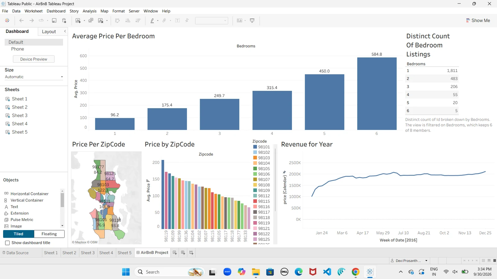
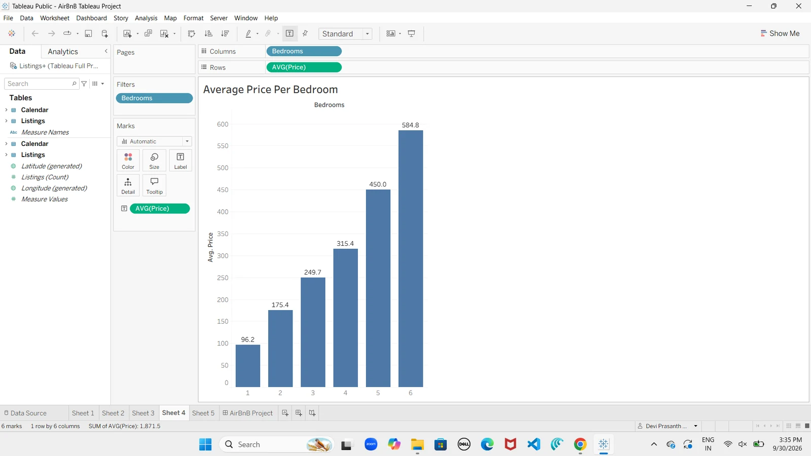
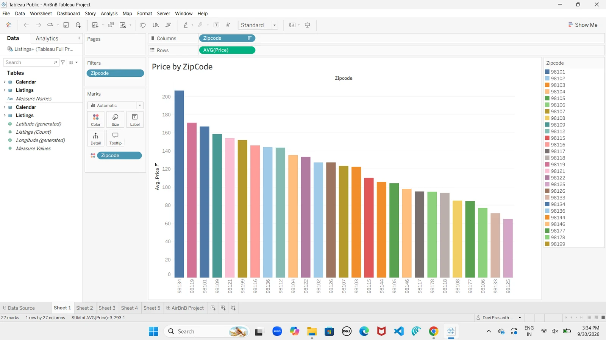
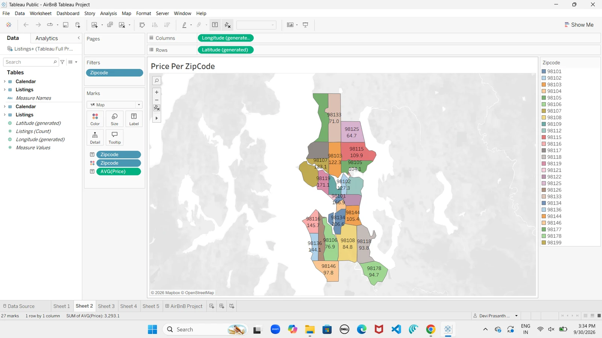
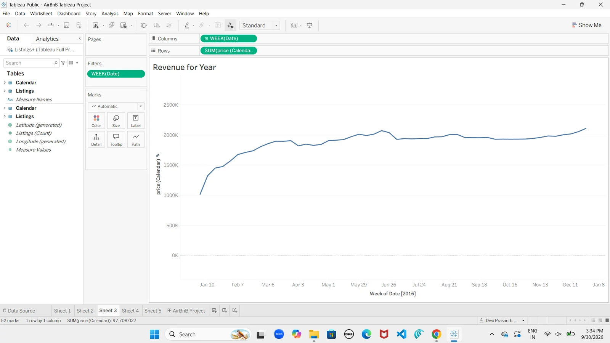
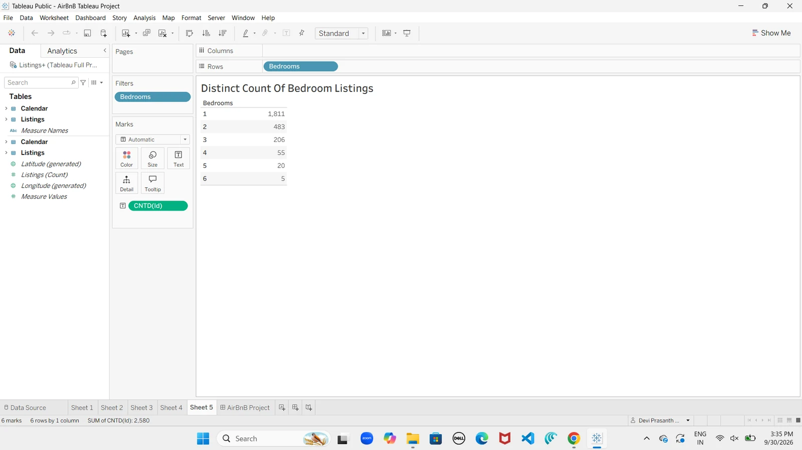

# Seattle AirBnB — Tableau Dashboard

An interactive Tableau dashboard exploring **Seattle AirBnB listings** — pricing by bedroom count, price distribution across zipcodes (bar + map), and a full year of booking revenue. Built as a portfolio project while learning Tableau, covering data prep, a two-table join, and five linked views brought together in one dashboard.

## 🔗 Live Dashboard

**[View the interactive dashboard on Tableau Public →](https://public.tableau.com/app/profile/devi.prasanth.karumanchi/viz/AirBnBTableauProject_17907364449780/AirBnBProject)**

No Tableau install needed — the live version is fully interactive (hover, filter, zoom the map) in any browser.

## Overview

This project takes the raw Kaggle Seattle AirBnB dataset — a `Listings` table and a `Calendar` table — joins them on the listing ID, and builds five worksheets that answer practical questions about the Seattle short-term rental market: what drives price, where the expensive neighborhoods are, and how booking revenue moves across the year. All five views are combined into a single interactive dashboard.

It was built as a guided, portfolio-level project as part of learning Tableau. The focus was on the core BI skills: preparing and joining data, building varied chart types (bar, line, filled map, text table), and assembling them into a coherent dashboard.

## Dashboard Preview

Individual views

**Average Price per Bedroom**

**Price by Zipcode (ranked)**

**Price per Zipcode (map)**

**Revenue for the Year**

**Distinct Count of Bedroom Listings**

## Key Views & What They Show

| View | Type | What it shows |
|------|------|---------------|
| **Average Price per Bedroom** | Bar chart | Average nightly price rises steadily with bedroom count — from **$96.20** (1BR) to **$584.80** (6BR). |
| **Distinct Count of Bedroom Listings** | Text table | Listing supply is concentrated in small units: **1,811** one-bedroom listings vs. just **5** six-bedroom, out of **2,580** total. |
| **Price by Zipcode** | Ranked bar chart | Average price by neighborhood, highest to lowest — from **~$207** (98134) down to **~$65** (98125). |
| **Price per Zipcode** | Filled map | The same price data on a geographic map of Seattle zipcodes, so pricing hot-spots are visible at a glance. |
| **Revenue for the Year** | Line chart | Weekly booking revenue across 2016 — climbing from **~$1M** in January and leveling around **~$2M**, totaling **~$97.7M** for the year. |

## Dataset

- **Source:** Kaggle — *Seattle AirBnB Open Data* (an earlier version of the dataset).
- **Tables used:** `Listings` (listing details, price, location, bedrooms) and `Calendar` (per-day availability and price).
- **Join:** `Listings.id` = `Calendar.listing_id` (inner join).
- The dataset is public and used here for educational/portfolio purposes; all credit for the data goes to its original authors.

## Tools & Skills

- **Tableau** (Public / Desktop)
- Multi-table **data joining** (Listings ↔ Calendar)
- **Calculated aggregations** (average price, distinct counts, summed revenue)
- **Geographic / map visualization** (filled zipcode map)
- Multiple chart types — bar, line, filled map, text table
- **Dashboard design** — combining linked views into one interactive layout

## Repository Contents

- `AirBnB Tableau Project.twb` — the Tableau workbook.
- `screenshots/` — dashboard and individual view images.
- `README.md` — this file.

> **Note:** The raw dataset is not included in this repository. It belongs to its original authors and is available from the Kaggle *Seattle AirBnB Open Data* source noted above. The workbook references that data locally, so use the live Tableau Public link for the finished, interactive result.

## How to Open

- **Easiest:** just use the **[live Tableau Public link](https://public.tableau.com/app/profile/devi.prasanth.karumanchi/viz/AirBnBTableauProject_17907364449780/AirBnBProject)** above — no install needed.
- **To open the workbook file:** the `.twb` requires [Tableau Public](https://www.tableau.com/products/public/download) (free) or Tableau Desktop. Note the workbook references the original data source, so the live link is the best way to view the finished result.

---

*Built by Devi Prasanth Karumanchi — part of an ongoing ML/AI and data portfolio. [Portfolio](https://prasanth006.github.io) · [GitHub](https://github.com/prasanth006)*
